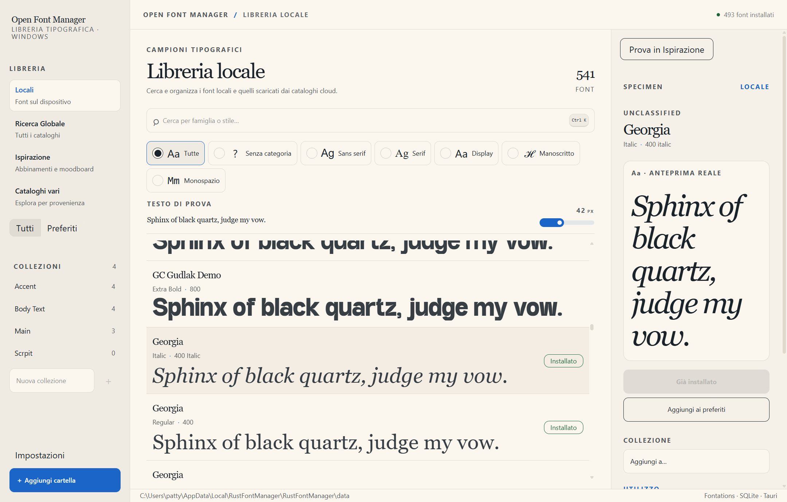
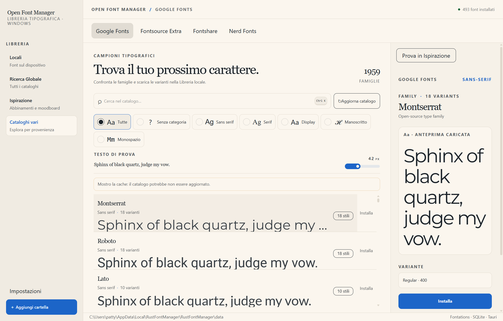
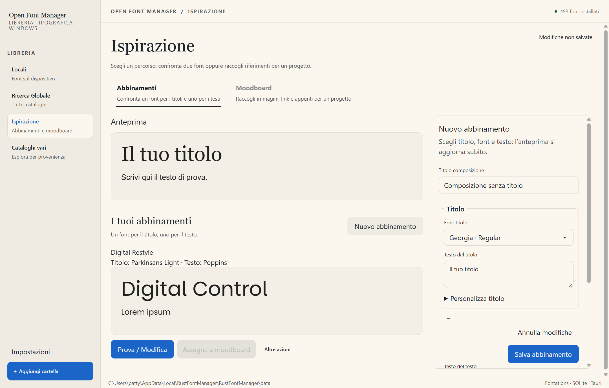

# Open Font Manager

[](https://github.com/Dade00/open-font-manager/actions/workflows/ci.yml)
[](LICENSE)
[](https://paypal.me/davidezmb)

A free, open-source font manager for **Windows 11 x64**, built with Rust, Tauri 2 and React. Browse local fonts, preview cloud catalogs, install fonts for your Windows user, and collect typography references in moodboards.

`README.md` uses the actual Italian control labels alongside English instructions.

> **v0.2.0 release.** The Windows x64 NSIS installer and update packages are signed with Tauri's updater key (minisign). The release workflow publishes the installer and updater metadata when a `v*` tag is pushed. This updater signature is separate from an Authenticode publisher signature; Windows SmartScreen may still show a warning for an unrecognized publisher.



*Captured from the native Windows app with real library data. Fonts and counts reflect the capture machine, not bundled content. Screenshots show the development UI, which may differ from the published prerelease.*

## Features

- Index system and per-user Windows fonts automatically, and scan additional folders.
- Read `.ttf`, `.otf` and `.ttc` files, including the faces in font collections.
- Search a local SQLite library, filter categories, customize previews, and organize favorites and collections.
- Install fonts persistently for the current Windows user; uninstall only installations managed by Open Font Manager.
- Browse Google Fonts, Fontsource Extra, Fontshare and Nerd Fonts, or search across sources with **Ricerca Globale**.
- Preview remote fonts on demand and bring downloaded fonts into the local library.
- Import valid desktop `.ttf` and `.otf` files by dropping ZIP archives onto the app.
- Copy CSS and Next.js font snippets from a local font's inspector.
- Compare heading and body fonts in **Ispirazione**, save pairings, and organize images, links, notes and font references in local moodboards.
- Inspect application paths, scan folders and catalog cache status in **Impostazioni**.

## Download and run

1. Open the [release page](https://github.com/Dade00/open-font-manager/releases/latest) and download the Windows x64 NSIS installer.
2. Run the installer and follow its prompts.
3. Allow the initial scan to finish before installing or removing fonts.

When a newer release is available, the app checks at startup and offers to download and install it after confirmation. Updating requires Internet access. Release installs are distributed with signed updater packages; the signature does not provide an Authenticode publisher certificate.

Windows 11 x64 and the Microsoft Edge WebView2 Runtime are required; WebView2 is normally already present on Windows 11.

## Usage

### Browse and organize local fonts

1. Choose **Locali**. Windows system and user font folders are indexed automatically.
2. Click **Aggiungi cartella** to scan another directory. Scanning existing files does not copy or install them.
3. Search for a family or style. In the local library and Google Fonts views, **Ctrl+K** focuses the search field.
4. Select a category, enter your own **Testo di prova**, and adjust the size slider. Select a row to see its specimen, metadata and actions on the right.
5. Click **Aggiungi ai preferiti** to bookmark a font; use **Preferiti** to see favorites.
6. Enter a name in **Nuova collezione** and click **+**. Select a font, then choose that collection from **Aggiungi a…** in the inspector.

### Install and remove fonts

Select a local font and click **Installa** to install it for your current Windows account. No administrator privileges are needed, and the font remains installed after the app closes.

- **Disinstalla** removes an installation managed by Open Font Manager, without deleting the original library file.
- **Già installato** indicates an existing external installation. Open Font Manager does not remove those installations.
- Installation uses the per-user font directory and HKCU registration, not `C:\Windows\Fonts`. Managed installations are restored at startup and the app sends `WM_FONTCHANGE` notifications.

Third-party applications decide when to refresh their font lists. If a font does not appear, try reopening the target application. Screenshots do not establish compatibility with every Windows application.

### Explore online catalogs

Choose **Cataloghi vari**, then **Google Fonts**, **Fontsource Extra**, **Fontshare** or **Nerd Fonts**. Use **Ricerca Globale** to search across catalogs and the local library instead.

In Google Fonts, click **Carica catalogo** if empty, or **Aggiorna catalogo** to refresh. Select a family, choose a **Variante**, inspect the preview, then click **Installa** to download and install that variant for your Windows user. Other providers expose their available variant or family actions in their own view. Downloaded fonts appear under **Locali**.



*Native capture with a loaded Montserrat preview. The visible cache warning is real: this is a previously saved catalog, which may be out of date.*

Initial catalog fetches, uncached previews and downloads need Internet access. Saved catalog metadata can remain available during provider outages; this does not mean every preview or font file is cached.

### Import a ZIP

Drop a `.zip` onto the native app window. Valid `.ttf` and `.otf` files are extracted into the managed font vault and indexed under **Locali**. Check the completion notification for unreadable files or partial imports.

**ZIP import alone does not install fonts in Windows.** Select an imported font and click **Installa** separately. Local `.ttc` files can be scanned, but ZIP import accepts only `.ttf` and `.otf`.

### Copy snippets

Select a local font and use **Copia CSS** or **Copia Next.js** in its inspector. These copy integration snippets to the clipboard; they do not add files to your web project or grant redistribution rights. Check the font's license before embedding or shipping it.

### Try pairings and build moodboards

1. Open **Ispirazione**, or click **Prova in Ispirazione** in a font inspector.
2. Under **Abbinamenti**, use **Nuovo abbinamento** to choose heading and body fonts, edit sample text, and compare the live preview. Additional style and subtitle controls are expandable.
3. Click **Salva abbinamento**, or **Aggiorna abbinamento** for an existing pairing. Leaving with unsaved changes prompts for confirmation.
4. Switch to **Moodboard**, choose **Nuova moodboard**, enter a name and click **Crea moodboard**.
5. Use **Aggiungi contenuto** for images, links, notes, fonts or saved compositions. A saved pairing can also be assigned using **Assegna a moodboard**.



*An unsaved pairing draft in the native app using local Georgia and Arial fonts, not a saved composition.*

### Manage scan folders and storage

Open **Impostazioni** to see the database/configuration path, catalog cache, font vault and Windows font directory. Add scan folders, pause them, rescan with **Scansiona**, or remove a configured root with **Rimuovi**.

Pausing or removing a root changes configuration only: it does not delete files or previously indexed fonts. Catalog cache status is shown separately for each provider.

## Build from source

### Requirements

- Windows 11 x64 and Microsoft Edge WebView2 Runtime.
- A current stable Rust toolchain with the `x86_64-pc-windows-msvc` target.
- Visual Studio Build Tools with the C++ workload and Windows SDK.
- Node.js **22.12 or newer** and npm.

The manifests' `rust-version` has not yet been verified as the minimum supported Rust version for the full lockfile.

```powershell
rustup target add x86_64-pc-windows-msvc
git clone https://github.com/Dade00/open-font-manager.git
cd open-font-manager
npm ci
npm run tauri -- dev
```

This starts Vite at `http://127.0.0.1:1420` and opens the native app. **`npm run dev` alone starts only the frontend**: an ordinary browser does not provide the Tauri IPC, filesystem, clipboard and dialog services required by the app.

Build the optimized Windows executable:

```powershell
npm run tauri -- build --no-bundle --target x86_64-pc-windows-msvc
```

Build the signed NSIS installer locally (the private signing key is required):

```powershell
$env:TAURI_SIGNING_PRIVATE_KEY = Get-Content -Raw C:\path\to\updater.key
npm run tauri -- build --target x86_64-pc-windows-msvc --bundles nsis
```

- `TAURI_SIGNING_PRIVATE_KEY` è un segreto GitHub Actions necessario per firmare ogni release; senza configurarlo il workflow non può pubblicare pacchetti updater utilizzabili. La chiave privata non va mai inserita nel repository; il secret `TAURI_SIGNING_PRIVATE_KEY_PASSWORD` è necessario se la chiave è protetta da password. La chiave pubblica corrispondente è configurata in `src-tauri/tauri.conf.json`. Tauri scrive l'installer in `target/x86_64-pc-windows-msvc/release/bundle/nsis/` e la firma updater accanto al bundle. Il workflow pubblica la release GitHub e i metadati updater al push di un tag `v*`.

`npm run build` checks TypeScript and builds frontend assets only, not the desktop executable.

## Tests and checks

Regular tests do not require Internet access:

```powershell
cargo fmt --all -- --check
cargo test --workspace --target x86_64-pc-windows-msvc
cargo clippy --workspace --all-targets --target x86_64-pc-windows-msvc -- -D warnings
npm test -- --reporter=dot
npm run build
```

The live Google Fonts test is marked `#[ignore]` because it depends on the public service. Run it explicitly with:

```powershell
cargo test -p rust-font-manager --target x86_64-pc-windows-msvc --test google_fonts_tests -- --ignored
```

## Known limitations

- Windows 11 x86_64 with the MSVC toolchain is the supported target. Other operating systems are not supported releases.
- Local `.woff`, `.woff2`, Type 1 and bitmap fonts are not supported.
- Catalogs and downloads depend on third-party services, which can change or become unavailable. Google Fonts access uses `google-webfonts-helper` at `gwfh.mranftl.com`.
- There is no system tray or Authenticode publisher signature. Tauri updater packages use a separate minisign signature; Windows SmartScreen may still warn about an unrecognized publisher.
- Full manual compatibility testing across Windows applications, frame-time profiling and mixed-DPI multi-monitor window testing are pending. Smoothness and stability should not be assumed from screenshots.

## Project layout

| Path | Responsibility |
| --- | --- |
| `src-tauri/src/lib.rs` | Tauri runtime, plugins and IPC |
| `src-tauri/src/backend.rs` | Desktop adapter to Rust services |
| `ui/src/` | React, TypeScript, Tailwind CSS and daisyUI interface |
| `src/font_scanner.rs` | OpenType metadata through Fontations |
| `src/db.rs`, `src/paths.rs` | SQLite library and application paths |
| `src/services/local_library.rs` | Local scanning |
| `src/services/font_install.rs` | Persistent per-user Windows installation |
| `src/win_font_loader.rs` | Windows font-change notifications |
| `src/google_fonts.rs`, `src/services/google_library.rs` | Google Fonts requests, cache and downloads |
| `src/services/zip_import.rs` | Safe ZIP extraction and font validation |
| `src/snippets.rs` | Integration snippets |

## Privacy and local data

The library, favorites, collections, moodboards and downloaded files stay on your device. Scanning existing fonts does not copy or install them, and the client does not send scanned local paths to catalog providers.

Catalog requests and downloads contact Google Fonts through `gwfh.mranftl.com`, Fontsource, Fontshare, GitHub for Nerd Fonts, and their distribution hosts. Moodboard links open in the system browser only when requested. Application data and cache use separate local directories; check **Impostazioni** for the actual paths.

## License

Open Font Manager's code is released under the [MIT license](LICENSE). Use, modification and redistribution, including commercial use, are permitted under that license. There is no usage fee.

Dependencies, fonts and other third-party content retain their own licenses. This repository's MIT license does not relicense them. See [THIRD_PARTY_NOTICES.md](THIRD_PARTY_NOTICES.md).

## Contributing and reporting issues

Read [CONTRIBUTING.md](CONTRIBUTING.md) for setup, checks and pull requests, [CODE_OF_CONDUCT.md](CODE_OF_CONDUCT.md) for community expectations, and [SECURITY.md](SECURITY.md) for private security. Planned work lives in GitHub issues labeled [`roadmap`](https://github.com/Dade00/open-font-manager/issues?q=is%3Aissue%20label%3Aroadmap%20) and in [docs/FEATURE-QUEUE.md](docs/FEATURE-QUEUE.md).

For bug reports, include the app version, Windows version, reproduction steps and exact error. For font issues, include the format and provider where possible; do not upload proprietary fonts without permission.

## Support the project

If Open Font Manager is useful to you, you can leave an optional tip through **[PayPal](https://paypal.me/davidezmb)**. Donations are not required to use the software and do not purchase support, priority or additional features.
